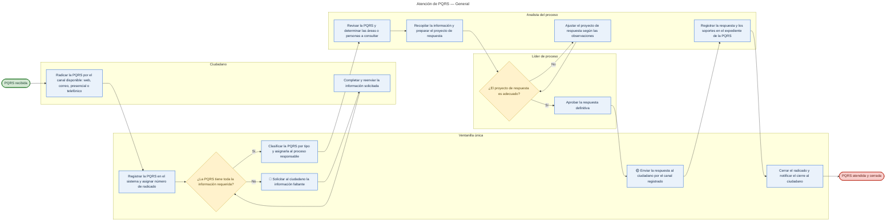

# Ejemplo de referencia — Atención de PQRS (General)

Diagrama de muestra que aplica todas las reglas de la skill. Sirve como referencia **provisional**
hasta tener un export real de Bizagi Modeler. Fuente: [`ejemplo-pqrs.mmd`](./ejemplo-pqrs.mmd).

## Estructura consultada al usuario

- **Inicio:** PQRS recibida. **Fin:** PQRS atendida y cerrada.
- **Fases:** Recepción → Análisis → Respuesta → Cierre.
- **Responsables (carriles):** Ciudadano, Ventanilla única, Analista del proceso, Líder de proceso.
- **Variaciones:** ninguna en este ejemplo (si las hubiera → un diagrama general + uno por variación,
  ver `../../references/04-variaciones-de-procedimiento.md`).

## Diagrama

## Pasos

| # | Fase | Responsable | Paso | Tipo | Caracteres |
|---|---|---|---|---|---|
| 1 | Recepción | Ciudadano | Radicar la PQRS por el canal disponible: web, correo, presencial o telefónico | Actividad | 76 |
| 2 | Recepción | Ventanilla única | Registrar la PQRS en el sistema y asignar número de radicado | Actividad | 59 |
| 3 | Recepción | Ventanilla única | ¿La PQRS tiene toda la información requerida? | Decisión | — |
| 4 | Recepción | Ventanilla única | Solicitar al ciudadano la información faltante | Actividad | 45 |
| 5 | Recepción | Ciudadano | Completar y reenviar la información solicitada | Actividad | 45 |
| 6 | Recepción | Ventanilla única | Clasificar la PQRS por tipo y asignarla al proceso responsable | Actividad | 61 |
| 7 | Análisis | Analista del proceso | Revisar la PQRS y determinar las áreas o personas a consultar | Actividad | 60 |
| 8 | Análisis | Analista del proceso | Recopilar la información y preparar el proyecto de respuesta | Actividad | 58 |
| 9 | Análisis | Líder de proceso | ¿El proyecto de respuesta es adecuado? | Decisión | — |
| 10 | Análisis | Analista del proceso | Ajustar el proyecto de respuesta según las observaciones | Actividad | 55 |
| 11 | Respuesta | Líder de proceso | Aprobar la respuesta definitiva | Actividad | 31 |
| 12 | Respuesta | Ventanilla única | Enviar la respuesta al ciudadano por el canal registrado | Actividad | 55 |
| 13 | Cierre | Analista del proceso | Registrar la respuesta y los soportes en el expediente de la PQRS | Actividad | 64 |
| 14 | Cierre | Ventanilla única | Cerrar el radicado y notificar el cierre al ciudadano | Actividad | 52 |

Todas las actividades ≤ 100 caracteres. ✅

## Tabla de validación

| # | Paso | Color | Comentario |
|---|---|---|---|
| 3 | ¿La PQRS tiene toda la información requerida? | 🟡 | No está definida la lista de campos obligatorios que hacen que una PQRS se considere "completa". |
| 4 | Solicitar al ciudadano la información faltante | 🔴 | No hay plazo ni número máximo de solicitudes; la PQRS puede quedar abierta indefinidamente sin respuesta del ciudadano. |
| 12 | Enviar la respuesta al ciudadano por el canal registrado | 🟡 | No se define el plazo máximo legal de respuesta ni qué ocurre si se vence. |
| Resto | — | 🟢 | Sin observaciones. |

**Leyenda:** 🟢 todo correcto · 🟡 parcialmente correcto, requiere revisar · 🔴 revisar obligatoriamente.

## Notas sobre este ejemplo

- Los carriles se representan con `subgraph`. Mermaid no permite anidar carriles y fases de forma
  legible, por eso la **fase** vive en la tabla de pasos, no en el lienzo.
- Las marcas 🟡 / 🔴 van como prefijo en la etiqueta del nodo; 🟢 no se marca. El detalle siempre
  en la tabla de validación.
- Sin paréntesis dentro de las etiquetas (rompen el parser de Mermaid); se usan dos puntos.
