fix:
- Presentacion del diagrama: no sale correctamente el diagrama, sale el codigo.
    ej: ´´´flowchart TD

  ini(["Necesidad de cambio o ajuste en el Mapa de Procesos identificada"]):::evInicio

  A1["1. Identificar la necesidad de cambio o ajuste en el Mapa de Procesos y diligenciar el FR-011-SIG
👤 Líder/Referente del Proceso Solicitante · 🔄 P"]:::actividad
  A2["2. Enviar el FR-011-SIG diligenciado al Profesional de Procesos y Calidad
👤 Líder/Referente del Proceso Solicitante · 🔄 H"]:::actividad
  A3["3. Revisar que el FR-011-SIG esté completo y permita entender el cambio sin consultar otros documentos
👤 Profesional de Procesos y Calidad · 🔄 H"]:::actividad
  G4{"4. ¿El FR-011-SIG tiene observaciones?
👤 Profesional de Procesos y Calidad · 🔄 H"}:::decision
  A5["5. Consolidar el análisis de impacto y de riesgos asociados al cambio en el FR-011-SIG
👤 Profesional de Procesos y Calidad · 🔄 H"]:::actividad
  A6["6. Remitir el FR-011-SIG diligenciado al Director de Planeación para su recomendación
👤 Profesional de Procesos y Calidad · 🔄 H"]:::actividad
  A7["7. Emitir la recomendación sobre el cambio y registrar la justificación en el FR-011-SIG
👤 Director de Planeación · 🔄 V"]:::actividad
  G8{"8. ¿Director de Planeación aprueba el cambio?
👤 Director de Planeación · 🔄 V"}:::decision
  A9["9. Presentar la solicitud con la recomendación ante el Comité de Calidad
👤 Profesional de Procesos y Calidad · 🔄 H"]:::actividad
  A10["10. Revisar la solicitud y registrar observaciones o condiciones de aprobación en el FR-011-SIG
👤 Comité de Calidad · 🔄 V"]:::actividad
  A11["11. Actualizar el Mapa de Procesos vigente conforme a la decisión del Comité de Calidad
👤 Profesional de Procesos y Calidad · 🔄 H"]:::actividad
  A12["12. Actualizar el Listado Maestro de Documentos y el repositorio documental
👤 Profesional de Procesos y Calidad · 🔄 H"]:::actividad
  A13["13. Cargar el Mapa de Procesos actualizado en la plataforma tecnológica: Almera / Intranet
👤 Profesional de Procesos y Calidad · 🔄 H"]:::actividad
  A14["14. Enviar notificación de la actualización mediante el boletín de novedades del SGC
👤 Profesional de Procesos y Calidad · 🔄 H"]:::actividad
  A15["15. Gestionar la actualización de riesgos e indicadores asociados, cuando aplique
👤 Líder/Referente del Proceso Solicitante · 🔄 A"]:::actividad

  fin(["Mapa de Procesos actualizado, publicado en la plataforma y socializado"]):::evFin

  N1["🟡 Paso 10 — No se define qué ocurre si el Comité de Calidad rechaza la solicitud"]:::notaAmarilla

  ini --> A1
  A1 --> A2
  A2 -.-> A3
  A3 --> G4
  G4 -- "Sí" -.-> A1
  G4 -- "No" --> A5
  A5 --> A6
  A6 -.-> A7
  A7 --> G8
  G8 -- "Rechaza / Aprueba con ajustes" -.-> A1
  G8 -- "Aprueba" -.-> A9
  A9 -.-> A10
  A10 -.-> A11
  A11 --> A12 --> A13 --> A14
  A14 -.-> A15
  A15 --> fin

  A10 -.-> N1

  classDef evInicio     fill:#92D050,stroke:#548235,stroke-width:2px,color:#26401A;
  classDef evFin        fill:#C00000,stroke:#7F0000,stroke-width:2px,color:#FFFFFF;
  classDef actividad    fill:#EAF0FC,stroke:#6F90AA,stroke-width:1.5px,color:#1A2E4A;
  classDef decision     fill:#FFFFCE,stroke:#AEB578,stroke-width:1.5px,color:#5B5A2E;
  classDef notaAmarilla fill:#FCF3CF,stroke:#F2C037,stroke-width:1.5px,color:#5B4A16,stroke-dasharray: 3 3;```

---

## Diagnóstico y solución

No es un problema del cliente (Claude Desktop): el `.mmd` de arriba tiene **sintaxis Mermaid
inválida**, por eso el parser no puede leer el archivo y el cliente cae a mostrar el código en
texto plano. Dos desviaciones frente a `assets/plantilla.mmd` (que sí está probada), las dos
repetidas por todo el archivo:

1. **Salto de línea real (Enter) dentro de las etiquetas** de `A1`…`A15` y `G4`/`G8`, en vez de
   `<br/>`. Ejemplo:
   ```
   ❌  A1["1. Identificar la necesidad...
   👤 Líder/Referente del Proceso Solicitante · 🔄 P"]:::actividad

   ✅  A1["1. Identificar la necesidad...<br/>👤 Líder/Referente del Proceso Solicitante · 🔄 P"]:::actividad
   ```
2. **Aristas con etiqueta que mezclan tipo de flecha** — abren con `--` (sólida) y cierran con
   `-.->` (punteada): `G4 -- "Sí" -.-> A1`, y las dos salidas de `G8`. La forma correcta para una
   arista **punteada** con etiqueta es con barras: `G4 -.->|"Sí"| A1` (la misma que ya usa
   `assets/plantilla.mmd` en PLANTILLA 2).

Reglas endurecidas para que no se repita: `SKILL.md` → "Reglas que no se negocian",
`references/02-reglas-de-diagramacion.md` → "⚠️ Etiquetas y flechas rotas: bug confirmado", y
`assets/plantilla.mmd` (cabecera). Ninguno de los demás `.mmd` de la skill (`plantilla.mmd`,
`ejemplo-pqrs.mmd`, `documentacion-software.mmd`, `induccion.mmd`) tenía este patrón — fue una
desviación puntual de esta generación, no un hueco en las reglas ya escritas; lo que sí faltaba
era hacerlas imposibles de pasar por alto, y eso quedó agregado.

Con la sintaxis corregida, Mermaid debería renderizarse solo al pegar el bloque en la
conversación (sin necesidad de HTML ni de ningún otro formato intermedio). **Pruébalo en Claude
Desktop** con esto:

```mermaid
flowchart TD

  ini(["Necesidad de cambio o ajuste en el Mapa de Procesos identificada"]):::evInicio

  A1["1. Identificar la necesidad de cambio o ajuste en el Mapa de Procesos y diligenciar el FR-011-SIG<br/>👤 Líder/Referente del Proceso Solicitante · 🔄 P"]:::actividad
  A2["2. Enviar el FR-011-SIG diligenciado al Profesional de Procesos y Calidad<br/>👤 Líder/Referente del Proceso Solicitante · 🔄 H"]:::actividad
  A3["3. Revisar que el FR-011-SIG esté completo y permita entender el cambio sin consultar otros documentos<br/>👤 Profesional de Procesos y Calidad · 🔄 H"]:::actividad
  G4{"4. ¿El FR-011-SIG tiene observaciones?<br/>👤 Profesional de Procesos y Calidad · 🔄 H"}:::decision
  A5["5. Consolidar el análisis de impacto y de riesgos asociados al cambio en el FR-011-SIG<br/>👤 Profesional de Procesos y Calidad · 🔄 H"]:::actividad
  A6["6. Remitir el FR-011-SIG diligenciado al Director de Planeación para su recomendación<br/>👤 Profesional de Procesos y Calidad · 🔄 H"]:::actividad
  A7["7. Emitir la recomendación sobre el cambio y registrar la justificación en el FR-011-SIG<br/>👤 Director de Planeación · 🔄 V"]:::actividad
  G8{"8. ¿Director de Planeación aprueba el cambio?<br/>👤 Director de Planeación · 🔄 V"}:::decision
  A9["9. Presentar la solicitud con la recomendación ante el Comité de Calidad<br/>👤 Profesional de Procesos y Calidad · 🔄 H"]:::actividad
  A10["10. Revisar la solicitud y registrar observaciones o condiciones de aprobación en el FR-011-SIG<br/>👤 Comité de Calidad · 🔄 V"]:::actividad
  A11["11. Actualizar el Mapa de Procesos vigente conforme a la decisión del Comité de Calidad<br/>👤 Profesional de Procesos y Calidad · 🔄 H"]:::actividad
  A12["12. Actualizar el Listado Maestro de Documentos y el repositorio documental<br/>👤 Profesional de Procesos y Calidad · 🔄 H"]:::actividad
  A13["13. Cargar el Mapa de Procesos actualizado en la plataforma tecnológica: Almera / Intranet<br/>👤 Profesional de Procesos y Calidad · 🔄 H"]:::actividad
  A14["14. Enviar notificación de la actualización mediante el boletín de novedades del SGC<br/>👤 Profesional de Procesos y Calidad · 🔄 H"]:::actividad
  A15["15. Gestionar la actualización de riesgos e indicadores asociados, cuando aplique<br/>👤 Líder/Referente del Proceso Solicitante · 🔄 A"]:::actividad

  fin(["Mapa de Procesos actualizado, publicado en la plataforma y socializado"]):::evFin

  N1["🟡 Paso 10 — No se define qué ocurre si el Comité de Calidad rechaza la solicitud"]:::notaAmarilla

  ini --> A1
  A1 --> A2
  A2 -.-> A3
  A3 --> G4
  G4 -.->|"Sí"| A1
  G4 -- "No" --> A5
  A5 --> A6
  A6 -.-> A7
  A7 --> G8
  G8 -.->|"Rechaza / Aprueba con ajustes"| A1
  G8 -.->|"Aprueba"| A9
  A9 -.-> A10
  A10 -.-> A11
  A11 --> A12 --> A13 --> A14
  A14 -.-> A15
  A15 --> fin

  A10 -.-> N1

  classDef evInicio     fill:#92D050,stroke:#548235,stroke-width:2px,color:#26401A;
  classDef evFin        fill:#C00000,stroke:#7F0000,stroke-width:2px,color:#FFFFFF;
  classDef actividad    fill:#EAF0FC,stroke:#6F90AA,stroke-width:1.5px,color:#1A2E4A;
  classDef decision     fill:#FFFFCE,stroke:#AEB578,stroke-width:1.5px,color:#5B5A2E;
  classDef notaAmarilla fill:#FCF3CF,stroke:#F2C037,stroke-width:1.5px,color:#5B4A16,stroke-dasharray: 3 3;
```



Si con esto Mermaid **sí** renderiza en Claude Desktop: el bug queda cerrado con la regla
endurecida, sin tocar el formato de salida. Si aun con la sintaxis válida el cliente sigue
mostrando el código (es decir, el problema no era la sintaxis sino que Desktop no renderiza
Mermaid pegado en el chat en absoluto): entonces sí vale la pena la ruta HTML que propones — pero
como plan B, después de confirmar que la A no alcanza.